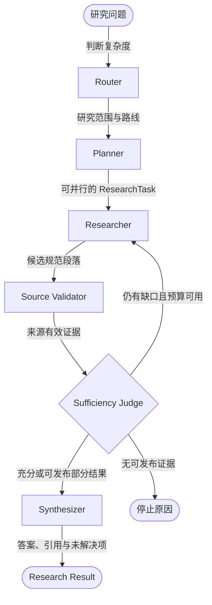

# SpecRAG：面向 3GPP 规范的证据型研究智能体

SpecRAG 在冻结的 3GPP Release 17 语料中研究自然语言问题：它分解任务、调用检索工具、验证来源与证据充分性，并生成带行内引用的答案。每次运行同时保存节点状态、工具调用、证据、停止原因和模型回执，便于恢复、复核与离线评测。

**Python 3.12 · FastAPI · LangGraph · MCP · React · SQLite · Chroma · LangSmith**

当前范围：**本地多用户工作区 · Release 17 · 34 份规范文档 · 50 题冻结 Benchmark**。

## 功能

- **任务规划**：Router 判断复杂度，Planner 生成带依赖关系的 `ResearchTask`。
- **有界检索**：Researcher 使用 BM25、向量检索、RRF、条款导航和交叉引用工具；轮次、工具和重规划均有预算。
- **证据验证**：Source Validator 校验来源路径、文档哈希、定位和摘录；未经来源支持的内容不能成为 Evidence。
- **缺口回路**：Sufficiency Judge 判断支持度、充分性与冲突，并将具体 `ResearchGap` 交回 Researcher。
- **可信综合**：Synthesizer 只使用通过验证且被 Judge 选中的证据，输出完整答案或明确限定的部分结果。
- **持久工作区**：Conversation、Run、事件、检查点、Result、Memory 和 SpecFact 持久化到 SQLite，并受工作区权限控制。
- **轨迹与评测**：LangSmith 用于观察；本地 Run、Evidence、回执和 Judge 文件是权威记录。

## LangGraph 如何运行

README 只展示业务节点；并行汇合、预算门禁和终止处理由 LangGraph 运行时在图内完成，但不在这里展开。



这张图回答“问题如何变成可审计的 Research Result”。Planner 产生的依赖就绪任务可以并行执行；Judge 发现证据缺口时触发有界补充研究。证据不足不等于系统崩溃：系统会发布限定结果，或保留明确的停止原因。

## 工程实现

| 部分 | 实现 |
| --- | --- |
| Workflow | LangGraph 条件边、任务并行、检查点、取消、恢复与有限重规划 |
| Retrieval | BM25 + dense retrieval + RRF；Clause Index、父子条款和交叉引用导航 |
| Evidence | 确定性来源校验 + 模型充分性判断 + 结构化缺口 + 引用约束综合 |
| Runtime | OpenAI-compatible Responses API、严格结构化输出、原生工具调用、有限重试 |
| Storage | SQLite WAL 保存身份、Workspace、Conversation、Run、队列、Result、Memory 与 SpecFact |
| Interfaces | React 工作台、FastAPI、Streamable HTTP MCP 和 CLI |
| Evaluation | 冻结 Benchmark、组件基线、LLM Judge、LangSmith 轨迹和跨模型配对分析 |

LangGraph 只存在于 `src/specrag/orchestration/`；检索、证据、Memory、授权和提供商适配器均可脱离图运行。详细边界见 [`docs/architecture/package_boundaries.md`](docs/architecture/package_boundaries.md)。

## Docker 快速开始

需要 Git、Docker Desktop 和 Docker Compose。完整 3GPP 语料不进入 Git，请先将已物化的 Release 17 语料放在 `data/3gpp/`。

```powershell
git clone https://github.com/QPoms/specrag.git
Set-Location .\specrag
Copy-Item .env.example .env
```

在 `.env` 中配置模型，并为 API → MCP 委托生成一个至少 32 字节的随机密钥：

```dotenv
OPENAI_BASE_URL=https://api.openai.com/v1
OPENAI_API_KEY=your_api_key
OPENAI_MODEL=your_model_id
SPECRAG_MCP_DELEGATION_SECRET=your_random_32_byte_secret

LANGSMITH_TRACING=false
LANGSMITH_API_KEY=
LANGSMITH_PROJECT=specrag
LANGSMITH_WORKSPACE_ID=
```

首次运行先构建镜像、激活语料并创建管理员，然后一条命令启动 Web、API 和 MCP/Research Worker：

```powershell
docker compose build
docker compose run --rm cli corpus sync --release 17 --apply
docker compose run --rm cli auth bootstrap --username alice
docker compose up -d
docker compose ps
```

打开 `http://127.0.0.1:5173`。API 同时监听 `http://127.0.0.1:8000`；MCP 只暴露在 Compose 私有网络，不发布宿主机端口。SQLite、索引和模型缓存保存在 Docker named volumes 中；`docker compose down` 会保留数据，只有显式增加 `-v` 才会删除这些卷。

## 自动化测试

```powershell
uv sync --extra dev --frozen
uv run python scripts/check.py

Set-Location frontend
npm install
npm run build
```

标准门禁检查包边界、模块大小、QA 数据、Benchmark 和全部 Python 测试。索引、运行记录、报告和缓存保存在被 Git 忽略的 `.local/` 或 `artifacts/`。

## 冻结评测

SpecRAG 的评测分为四层：组件隔离评测检查每个阶段，人工端到端评测检查完整任务是否成功，LLM Judge 为模型比较逐项打分，轨迹遥测记录调用、重试、Token、工具和来源完整性。各层使用独立口径，不把工具次数或自评充分性直接当作质量。

### Benchmark

| 项目 | 冻结值 |
| --- | ---: |
| Benchmark | `specrag-release17-final-answer/1.0.0` |
| Release 17 问题 | 50（34 simple，16 complex） |
| 加权 Rubric 条目 | 129 |
| Gold Evidence | 72 段已知充分、非排他证据 |
| 固定语料环境 | 34 份规范文档及精确哈希 |
| Final-answer Judge | `deepseek-v4-pro` / `final-answer-rubric-judge/v1.1` |

Reference Answer、Rubric 和 Gold Evidence 只进入评测器，不提供给被测 Workflow。Judge 仅返回每个 Rubric 的 `full/partial/none`，0–100 分由程序按冻结权重确定性计算；`no_answer` 明确计零，Judge 执行失败则保留空分数。

### 组件回归基线

| 组件 | 隔离范围 | 正式指标 |
| --- | ---: | --- |
| Router | 50 个问题 | Accuracy **0.9000**；Macro-F1 0.8927 |
| Planner | 18 个分解问题 | Task Coverage **0.8241**；Full Coverage 0.6111；Overlap 0；Out-of-Scope 0 |
| Retriever | 78 次固定调用 | Recall@5 **0.8761**；nDCG@5 0.8738 |
| Researcher | 78 个 GoldResearchTask | Evidence Coverage **0.9872**；Precision 0.6178 |
| Sufficiency Judge | 50 个黄金充分候选池 | Coverage **0.9800**；Precision 0.9080；Overlap 0.1020 |
| Synthesizer | 50 份独立证据输入 | Coverage **0.9750**；Groundedness 0.9937；Citation Correctness 0.9567 |

这些是 Release 17 开发集上的隔离工程基线：Planner 接收审查后的路由，Researcher 接收 GoldResearchTask，Judge 接收黄金充分候选池，Synthesizer 接收独立批准证据，因此分数不能相加为端到端总分。

### 人工端到端基线

2026-10-18 的完整 Workflow 基线逐题运行并人工复核全部 50 项决定。自动 Judge 最初提出 43 项成功；人工审计将其中 5 项因遗漏核心 Answer Unit 改为失败。

| 质量指标 | 结果 | 效率指标 | 结果 |
| --- | ---: | --- | ---: |
| Task Success | **38/50（76.0%）** | 平均 / P95 延迟 | 79.183 / 191.969 s |
| Simple | 29/34（85.3%） | LLM 调用 | 450；平均 9.00 |
| Complex | 9/16（56.2%） | 工具调用尝试 | 289；平均 5.78 |
| 正常最终答案 | 49/50 | 完整 Token 遥测 | 49/50 Runs |
| 运行或预算失败 | 1/50 | 49 个完整 Run Token | 2,652,796 |
| 人工复核 | 50/50 | 全批次已观测 Token 下限 | 2,761,525 |

失败标记包括 11 项核心结论缺失、1 项运行失败、1 项重大错误、1 项重大无依据主张和 2 项核心引用错误；同一问题可以同时具有多个失败标记。由于一次重试缺少失败请求的 usage，全批次精确 Token 总量有意不报告。完整分母和逐题失败见 [`docs/end_to_end_evaluation.md`](docs/end_to_end_evaluation.md)。

### 当前模型比较

2026-11-03 至 2026-11-04 的两次实验固定 Workflow、Benchmark、语料快照、预算、Judge 和 Prompt；每个候选模型只运行一次。

| Workflow 模型 | 完成 | Judge scored | no_answer | Overall | Simple | Complex | 满分题 | 中位数 |
| --- | ---: | ---: | ---: | ---: | ---: | ---: | ---: | ---: |
| `gpt-5.6-sol` | 50/50 | 50/50 | 0 | **92.40** | **93.68** | 89.69 | 38 | 100 |
| `gpt-6-astra` | 50/50 | 48/50 | 2 | 90.75 | 90.66 | **90.94** | 38 | 100 |

| 配对口径 | Astra 高 | 相同 | Sol 高 | Astra − Sol |
| --- | ---: | ---: | ---: | ---: |
| 全 50 题，`no_answer=0` | 8 | 36 | 6 | -1.650 |
| 双方均正常回答的 48 题 | 8 | 36 | 4 | **+2.448** |
| Simple 34 题 | 5 | 25 | 4 | -3.015 |
| Complex 16 题 | 3 | 11 | 2 | **+1.250** |

Astra 的 `r17-qa-002` 和 `r17-qa-033` 完成 Workflow 但没有最终答案；因此本轮表现应解释为“Astra 已回答题质量略高，Sol 答案产出覆盖率更好”。`r17-qa-012` 与 `r17-qa-029` 存在相似答案得分差异，已列为 Judge 人工校准重点。

### 执行与轨迹遥测

| 指标 | `gpt-5.6-sol` | `gpt-6-astra` |
| --- | ---: | ---: |
| Workflow 完成 | 50/50 | 50/50 |
| 逻辑模型调用 | 469 | 545 |
| Provider 实际尝试 | 845 | 858 |
| 额外 Provider 重试 | 376 | 313 |
| 完整 usage 调用 | 465/469 | 542/545 |
| 已观测输入 / 输出 Token | 2,971,337 / 311,666 | 3,101,168 / 339,622 |
| Run 平均 / 中位耗时 | 231.5 / 99.5 s | 274.3 / 209.3 s |
| 原始工具记录 / 预算计费调用 | 299 / 278 | 240 / 238 |
| 来源完整性校验通过 | 1,031/1,031 | 833/833 |
| Router / Planner 调用 | 50 / 19 | 50 / 17 |
| Researcher / Sufficiency Judge / Synthesizer 调用 | 262 / 88 / 50 | 347 / 83 / 48 |
| stop reason：completed / replan / tool budget | 49 / 0 / 1 | 46 / 3 / 1 |

Token 只汇总有 usage 的调用，是已观测下限；模型调用次数、证据数量和自评充分性属于执行特征，不代表阶段质量。Router、Planner、Researcher、Judge 和 Synthesizer 的质量结论只采用上面的隔离 Gold 评测。

当前仍是单次 trial，不计算 Pass@k、Pass^k、通过阈值或统计显著性，Final-answer Judge 的人工校准也仍需继续。

```powershell
uv run python scripts/evaluate_model_comparison.py analyze `
  artifacts/evaluations/model-comparison/analysis/REPORT-ID `
  artifacts/evaluations/model-comparison/EXP-A/comparison.json `
  artifacts/evaluations/model-comparison/EXP-B/comparison.json
```

## 目录与文档

```text
src/specrag/
  orchestration/   LangGraph 节点、边、并行调度和恢复
  agents/          有界 Researcher 循环
  retrieval/       语料、索引、检索、导航和重排
  evidence/        来源验证、充分性、缺口和综合
  tools/           模型工具及统一注册表
  interfaces/      CLI、FastAPI、MCP 和应用组合
  infrastructure/  模型、向量库与 SQLite 适配器
  evaluation/      离线 Benchmark、指标与报告
frontend/           React + TypeScript 工作台
data/QA/            问题与经审查评测输入
```

- [当前实现状态](docs/current_status.md)
- [包边界](docs/architecture/package_boundaries.md)
- [端到端 Benchmark](docs/end_to_end_benchmark.md)
- [模型比较实验契约](docs/plans/046-multi-model-langsmith-evaluation.md)
- [跨实验分析契约](docs/plans/047-cross-experiment-analysis.md)
- [Docker Compose 部署契约](docs/plans/048-docker-compose-deployment.md)

当前产品范围固定为本地 Release 17。Memory 和 SpecFact 只能提示研究方向，不能直接成为 Evidence；规范性结论仍须检索、验证并引用原始规范。项目变更必须遵守 [`AGENTS.md`](AGENTS.md)。
