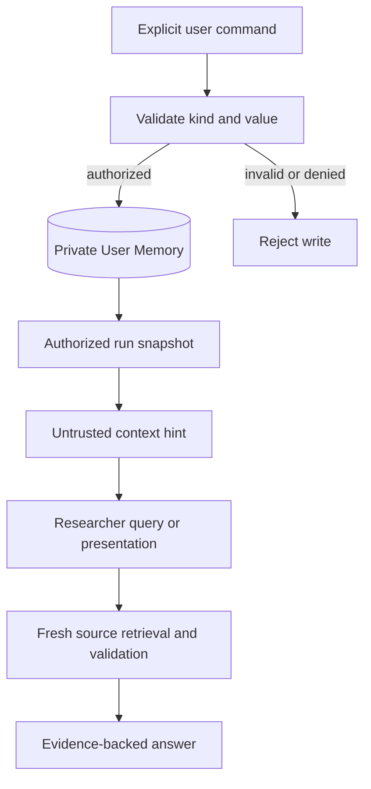

# Multi-user research workspace: domain, access, runtime, and reuse

Status: implemented on `feat/complex-researcher-freeze`.

Implementation note: the ignored `data/memory/` directory contained no active
persisted records, so the active schema was migrated directly and no empty data
migration utility was added. The implementation uses one numbered SQLite
schema, one CLI, one research workflow, and one SpecFact store.

## Goal and starting point

Build one multi-user 3GPP research workspace on top of the existing retrieval,
Researcher, evidence, and LangGraph path. A user can run and inspect research;
private material remains private; reviewed specification facts can be shared
within an authorized workspace; personal memory affects only that user's
research context.

The project owner accepts the current single-user baseline as sufficient to
start this work, not as a 100% quality claim. The recorded 50-question
2026-10-13 full-workflow batch has 47 completed, sufficient runs. Later focused
reruns do not change that batch result. Keep the three incomplete cases as
regressions and collect fresh questions before claiming generalization.

This plan covers the next four milestones only: domain contracts, identity and
authorization, runtime Harness, and SpecFact/User Memory integration. A UI,
private-document upload, external observability vendor, and large-scale search
backend are later decisions, not prerequisites for these milestones.

## Non-negotiable boundaries

- `Evidence` is source-backed material for a research run. It retains source
  path, document hash, Release, exact version, and locator.
- `SpecFact` is a reusable assertion derived from validated evidence and
  reviewed before sharing. It is not a user preference and is never a
  substitute for checking and citing the underlying source.
- `UserMemory` is user-owned preference or research context. It may guide
  retrieval and presentation but cannot become evidence or a SpecFact by
  itself. Initially, users explicitly create or edit it; do not infer and
  persist personal facts automatically.
- `ResearchState` and LangGraph checkpoints record execution progress for one
  run. They do not own SpecFacts or User Memory.
- `CorpusScope` continues to express version selection. Authorization is a
  separate trusted scope; do not encode permissions in Release/version policy.
- Keep one supported CLI and one research workflow. Extend current services;
  do not build a second RAG pipeline, another Agent framework, or a parallel
  knowledge store.

## Phase 2: domain and data contracts

Before moving code, write down these contracts and transition rules in this
plan and focused model tests:

| Object | Owner and visibility | Creation and lifecycle | Core invariants |
| --- | --- | --- | --- |
| `Run` | One initiating user in one workspace; visible only through an explicit workspace policy | Created on request; queued/running/completed/failed/cancelled; run metadata retained under a documented retention rule | Opaque run ID; immutable initiating identity and authorized corpus scope; checkpoint and artifacts reference this run |
| `Evidence` | Inherits the source document's visibility; attached to a Run and ResearchTask | Produced only by retrieval and source validation; run audit retained or deleted with its Run | Existing source path, hash, Release, exact version, heading, and line locator remain mandatory; no model text promoted to evidence |
| `SpecFact` | Initially workspace-scoped; no implicit cross-workspace/global sharing | Proposed only from sufficient, source-valid, cited claims; reviewed, approved, superseded, conflicted, or invalidated | Assertion, conditions, exact source identities, reviewer, validation time, and version scope survive every transition; source recheck precedes use in an answer |
| `UserMemory` | Owned by one user; private by default | Explicit create/update/delete; optional expiry | Type and owner are explicit; preference or research clue never satisfies a normative evidence requirement |
| `Checkpoint` | Belongs to a Run, accessed only after Run authorization | Saved at graph boundaries; resumed, expired, or removed under retention policy | Contains execution state, not durable domain knowledge; thread ID alone grants no access |

First map the existing `ValidatedKnowledge` fields and tests to the SpecFact
contract. Reuse its provenance, supersession, conflict, invalidation, and
validated-only write rules. Add proposal/review states without allowing a
pending proposal into shared retrieval. Decide how existing ignored JSONL
records are migrated before changing their active wire schema. If no persisted
records exist, document that fact and skip a migration utility.

**Gate:** the five objects, visibility rules, permitted state transitions, and
trusted versus model-supplied fields are reviewed together. No user or
workspace identifier is accepted from model output.

## Phase 3: identity and authorization

1. Add `User`, `Workspace`, `Membership`, and a trusted request/run access
   context. Start with member, reviewer, and workspace-admin permissions. Public
   3GPP corpus remains readable; private workspace sources and run artifacts
   require membership. SpecFact approval requires reviewer permission.
2. Put authorization decisions in one framework-independent policy service.
   Missing actor, workspace, membership, or source grant means deny. The
   application authenticates the caller and constructs trusted context before
   Router, Planner, Researcher, or resume is entered.
3. Resolve the allowed source set before corpus discovery/search. Apply it in
   lexical and vector candidate generation, clause lookup, context expansion,
   reranking inputs, and the source validator. Shared index/cache identities
   must include the visibility scope or physically partition data; never rely
   on final-answer filtering. If a backend cannot enforce this, do not put
   private documents into that backend.
4. Gate Run, checkpoint, artifact, SpecFact, and User Memory reads/writes at
   their owning services. Resolve an opaque `thread_id` through an authorized
   Run; possession of a thread ID is not authorization. Preserve the same
   context through parallel workers and resumed dependency waves.

**Gate:** integration tests with two users and two workspaces reject every
cross-scope read, search, resume, citation, and cache hit. A reviewer can
approve only facts in their workspace. Existing public-corpus research still
works for an authorized local workspace.

## Phase 4: durable runtime Harness

1. Keep `ResearchState` as the execution contract. Persist checkpoints through
   an injected checkpointer instead of the default in-memory saver for the
   multi-user deployment. Use a durable Run record to resolve ownership and
   retention separately from the checkpoint payload.
2. Emit provider-neutral Run events at graph transitions and tool boundaries:
   task dispatch, proposed/accepted/rejected call, evidence selection, source
   validation, Judge decision, gap, replan, synthesis, stop, cancellation, and
   resume. Correlate by workspace, Run, task, and call IDs. Store redacted model
   receipts and aggregate latency/token usage by stage.
3. Add a cancellation signal, elapsed-time limit, and explicit terminal reason
   without weakening existing per-task tool, round, and replan budgets. Handle
   expected provider failures at the owning adapter. Do not swallow unknown
   failures as successful answers.
4. Make external writes idempotent by stable operation keys, especially
   SpecFact proposal/approval and User Memory writes. A resumed node may run
   again; checkpoint recovery alone does not make its side effects exactly once.
5. Provide one supported resume path and a compact run diagnostic view through
   the existing CLI/application surface. Do not create a second workflow entry.

**Gate:** kill and restart a run between graph nodes, resume it under the same
authorized Run, and obtain one final answer without duplicate durable writes.
Another user cannot resume it. Its event record explains the stop reason,
budget use, and evidence path. In-memory checkpointing stays available for
tests and local development only.

## Phase 5: SpecFact and User Memory integration

1. Mechanically move the existing validated-knowledge implementation to the
   SpecFact owner, updating imports/callers/tests and deleting replaced paths
   in the same change. Preserve current behavior before adding review and
   workspace scope. Do not leave `ValidatedMemoryService` and a new SpecFact
   service as two supported implementations.
2. After synthesis, create pending SpecFact proposals only from claims whose
   evidence is source-valid and Judge-supported. Reviewer approval is a
   separate authorized transition. On read, filter by workspace, status,
   Release/version, source validity, and current access before offering facts
   to Researcher as search hints.
3. Implement personal memory as a separate small service with explicit user
   ownership. Begin with default Release, answer language/detail preference,
   followed topics, and saved research leads. Keep edits auditable and allow
   deletion. Feed selected items to Researcher/presentation as context only;
   they never enter Source Validator or Sufficiency Judge as evidence.
4. Keep SpecFact and User Memory out of checkpoint state except for stable IDs
   and usage audit. A run reads an authorized snapshot of each; a later write
   does not silently change the meaning of an in-progress run.

### User Memory contract (implemented design)

User Memory is deliberately smaller than a general-purpose semantic memory
system. It stores user-owned context that can change how a request is presented
or where a researcher starts looking, but it never asserts what the
specification says:

| Layer | Owner | Trust | Used by | Cannot do |
| --- | --- | --- | --- | --- |
| RunState/checkpoint | one Run | runtime state | graph resume and inspection | become durable user knowledge |
| UserMemory | one user in one workspace | untrusted context | configuration and research hints | satisfy Source Validator/Judge or create SpecFact |
| SpecFact | workspace | reviewed, source-linked hint | shared retrieval planning | replace a fresh source check |
| Evidence | source document and Run | source-backed | Judge and synthesis | be created from model text alone |

The first implementation accepts only explicit user writes. Each item has a
typed kind, origin, immutable revision number, predecessor ID, expiry/status,
and stable operation key. Supported kinds are `default_release`,
`answer_language`, `detail_level`, `followed_topic`, and `research_lead`.
Automatic LLM extraction is intentionally not enabled; adding a trusted import
origin later must go through a separate reviewable policy.

The kinds have two explicit read paths. `default_release`, `answer_language`,
and `detail_level` participate only in configuration resolution, and only the
selected revision IDs are recorded on the Run. `followed_topic` and
`research_lead` form the untrusted Researcher context. Configuration memories
are never copied into the model context as general instructions.

The snapshot records exact Memory IDs; resume loads those authorized revisions,
so later edits or deletion do not change an in-progress Run. Memory context is
marked `untrusted_context` and is never passed as Evidence to Source Validator,
Sufficiency Judge, or SpecFact proposal logic.

Workspace admins may inspect, cancel, or resume member Runs, but cannot use the
normal Memory APIs to list, change, or delete a member's private items. During
resume, the application may load only the exact owner-scoped Memory IDs already
captured by that authorized Run; it cannot browse the owner's other memories.

**Gate:** approved same-workspace facts can help a second user find the same
source, while pending/invalid/other-workspace facts cannot. Two users' personal
memories remain isolated. The final answer still cites checked source evidence.

## Code placement and migration map

Follow `docs/architecture/package_boundaries.md` and update it when a package
first receives working code. The paths below are ownership targets, not empty
scaffolding to create up front.

| Responsibility | Placement and treatment of existing code |
| --- | --- |
| Pure contracts for actor, workspace, membership, access scope, Run, SpecFact, User Memory, and events | `models/`; evolve `models/research.py` for run/task/evidence fields, and move `models/knowledge.py` to the SpecFact contract when that migration begins. Create only cohesive model modules that have active callers. |
| Authorization policy and workspace membership decisions | New `access/` package only when Phase 3 code exists; it depends on `models`, never on LangGraph or provider SDKs. Identity-provider and membership persistence adapters belong in `infrastructure/`. |
| Corpus and retrieval filtering | Extend `retrieval/corpus.py`, indexing/search modules, and current `tools/` requests/registry with an already-authorized source selection. Retrieval does not decide user roles and must not import `access` or `orchestration`. |
| Source validation, sufficiency, and synthesis | Extend existing `evidence/` services to reject inaccessible source identities and preserve claim-to-source rules. Do not implement permissions inside prompts. |
| Bounded Researcher | Extend `agents/researcher.py` and its state/policy modules to consume only injected, authorized search and context interfaces. It gets read-only SpecFact and User Memory views, never their write services. |
| Graph state, scheduling, checkpoint, resume, cancellation, event emission | `orchestration/`; extend `state.py`, `workflow.py`, `parallel.py`, and `application.py`. A LangGraph checkpointer adapter also lives here because LangGraph imports are restricted to this package. Graph nodes call injected services for domain decisions. |
| Durable Run/event, identity, SpecFact, and User Memory persistence; provider usage receipts | `infrastructure/`; rename/migrate `infrastructure/memory_store.py` with the SpecFact service, then add a distinct personal-memory adapter when used. Generic event/Run stores cannot import LangGraph. |
| Validated specification-fact lifecycle | Move current `memory/service.py` behavior to a new `specfacts/` package when Phase 5 has working callers; evolve rather than duplicate it. The existing `memory/` package then owns only User Memory. Update `AGENTS.md` and package-boundary documentation in the migration change. |
| Offline metrics and diagnostics | `evaluation/` and existing `scripts/` for offline runners; runtime event emission stays in `orchestration/`, not `evaluation/`. Generated outputs remain under ignored `artifacts/` or `.local/`. |
| Tests | Follow active package ownership in `tests/`; update/delete tests for moved behavior in the same change. Cover policy denial, retrieval isolation, source validation, resume ownership, idempotency, SpecFact review, and personal-memory isolation. |

## Delivery discipline

- Land one phase at a time, keeping the supported CLI usable. For every
  cross-package slice, add behavior tests, migrate existing callers, remove
  replaced imports/modules/tests, then update `README.md`,
  `docs/current_status.md`, and package boundaries if behavior or layout moved.
- Keep `pyproject.toml` as the only dependency manifest. Add storage/network
  dependencies only when a working adapter requires them. Keep generated
  indexes, checkpoints, events, and runs outside `src/` and ignored by Git.
- Run `python scripts/check.py` for each implementation slice. Add a focused
  two-user end-to-end acceptance run before claiming the multi-user workspace
  complete. Keep the current single-user failures visible as regression cases;
  do not invent a combined 48/50 result from separate runs.
